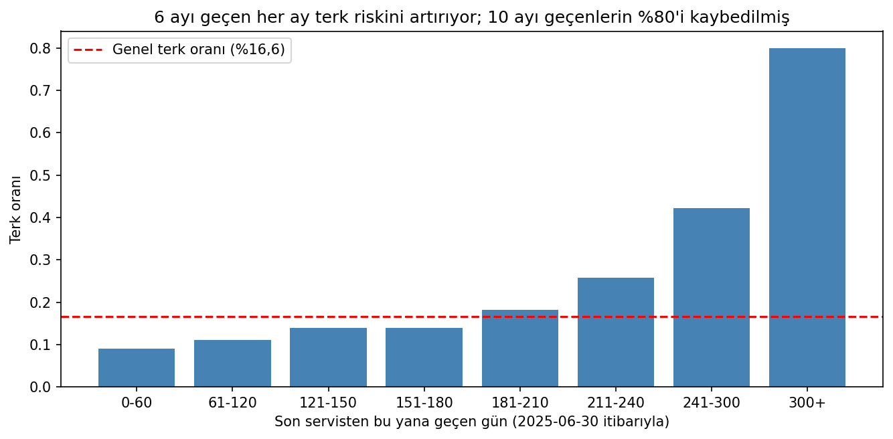
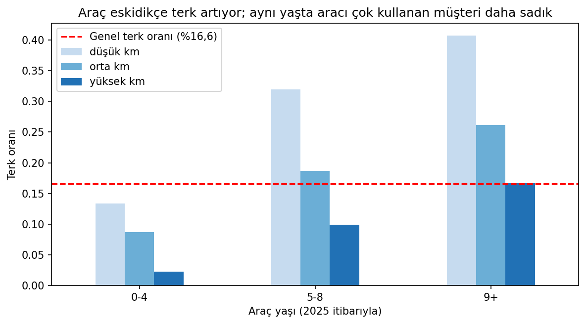
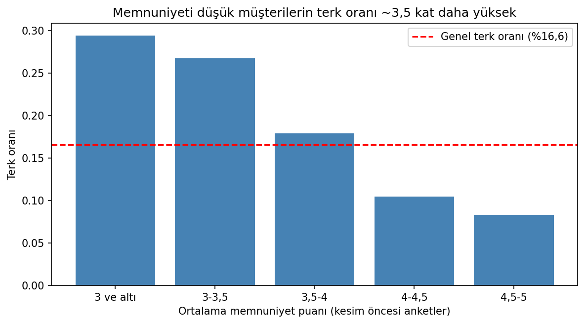
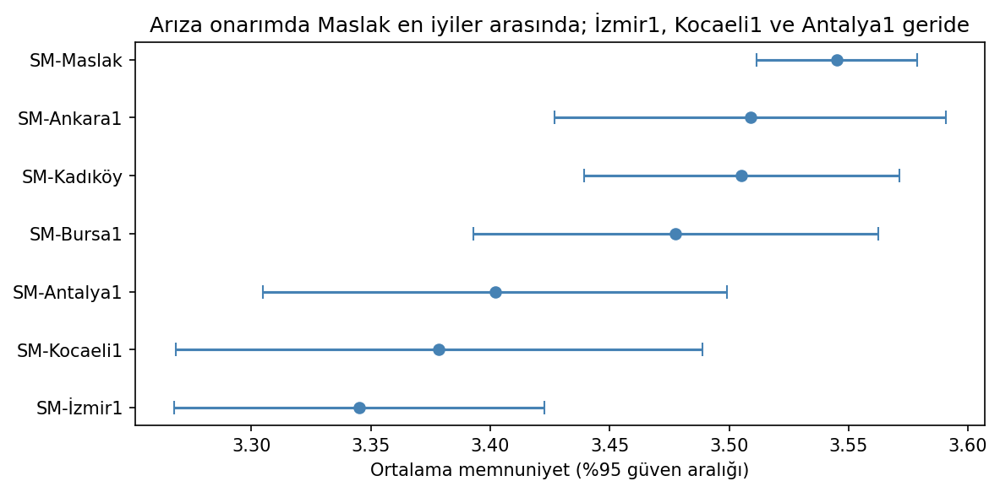
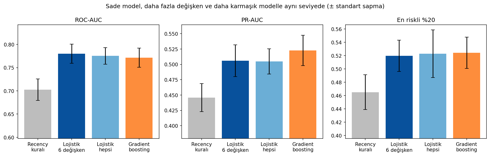
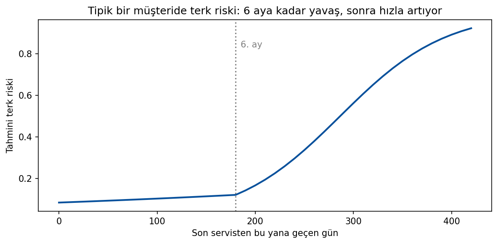

# Müşteri Terk ve Geri Bildirim Analizi — Rapor

**Hazırlayan:** Şevval Yavaş
Kodlar `kod/` klasöründe, her bölüm için ayrı bir notebook olarak yer alıyor. Çıktılar `ciktilar/` klasöründe, çalıştırma talimatları ise `README.md` dosyasında.

## Özet

Kesim tarihinden önce servise gelmiş 3.974 müşterinin %16,6'sı, sonraki bir yıl boyunca hiç servise gelmedi. Terki en iyi açıklayan sinyal, son servisten bu yana geçen süre: Risk ilk altı ay boyunca düşük ve sabit kalıyor, altıncı aydan sonra ise hızla artıyor. Araç yaşı, aracın ne kadar kullanıldığı (km) ve müşteri memnuniyeti de birbirinden bağımsız etkiler taşıyor.

Altı değişkenli bir lojistik regresyon modeli (ROC-AUC 0,78), "en uzun süredir gelmeyen müşteriyi ara" şeklindeki basit kuralı belirgin şekilde geçiyor. Daha karmaşık modeller ise daha iyi sonuç vermiyor.

Geri bildirimleri etiketleyen LLM, duyguyu %89–92 oranında doğru buluyor; ancak ironiyi ve çift olumsuz yapıları sistematik olarak kaçırıyor. Bu hata yüzünden, terk riski en yüksek olan şikâyetçi müşteri aksiyon listesine girmedi.

---

## Bölüm 1 — Veri hazırlığı ve keşif

### 1.1 Analiz tablosu

Dört dosyayı doğrudan satır seviyesinde birleştirmek yerine, her birini önce müşteri seviyesine özetledim ve ardından `musteri_id` üzerinden birleştirdim. Servis kayıtları ve geri bildirimler araçlara bağlı olduğu için, satır seviyesinde birleştirme satır sayısını şişirirdi. Analiz popülasyonu, kesim tarihinden önce en az bir servis kaydı olan **3.974 müşteri**den oluşuyor. Tablo 17 sütun içeriyor (`ciktilar/analiz_tablosu.csv`).

- **RFM metrikleri** yalnızca kesim tarihinden önceki kayıtlardan hesaplandı ve recency kesim tarihine göre ölçüldü. Ortanca müşterinin son servisi 102 gün önce, toplam ziyareti 6 ve toplam harcaması yaklaşık 67.700 TL. Aynı araç için aynı gün birden fazla kayıt bulunmadığından, her servis kaydını bir ziyaret olarak saydım.
- **Ek değişkenler:** ortalama memnuniyet, ankete cevap verme oranı, arıza onarımı oranı, kesimden önceki son km, araç sayısı ve en yeni aracın yaşı, müşteri tipi, şehir, kayıt kanalı ve geri bildirim sayısı. Kesimden sonra satın alınan 180 araç ve aracın satın alma tarihinden önce yazılmış 74 geri bildirim (büyük ihtimalle aracın önceki sahibine ait) hesaba katılmadı.
- **Satır fazlası:** Kopyalar temizlenmeden yapılan birleştirme, 32.770 servis kaydından 33.047 satır üretiyordu. Fazladan oluşan 277 satırın sebebi, 35 kopya müşterinin bütün servis kayıtlarının iki kez eşleşmesiydi.
- **Veri sızıntısı:** `crm_musteri_durumu` ve `son_iletisim_notu` alanları terk gerçekleştikten sonra dolduruluyor. Örneğin durumu "Kaybedildi" olan müşterilerin tamamı terk etmiş. Bu yüzden bu iki alanı hiçbir analizde özellik olarak kullanmadım.

### 1.2 Veri kalitesi: en önemli üç sorun

| Sorun | Bulgu | Karar ve gerekçe |
|---|---|---|
| **Kopya kayıtlar** | 35 müşteri ve 310 servis satırı, bütün sütunlarıyla birebir kopyaydı. Bu kopyalar birleştirmede 277 fazla satır oluşturuyordu. | Kopyaları sildim. Satırlar tamamen aynı olduğu için hiçbir bilgi kaybolmadı; silinmeseydi bu müşterilerin ziyaret sayısı ve harcaması iki kat görünecekti. |
| **Tarih biçimleri** | Servis tarihleri dört farklı biçimde yazılmıştı. Kayıtların yaklaşık %24'ü (7.894 kayıt), gün ile ayın karıştırılabileceği biçimdeydi. | Her biçimi açık bir kalıpla çevirdim. Gün ve ay sırasını veriyle doğruladım: Bu biçimlerde ikinci sayı hiçbir kayıtta 12'yi geçmiyor, yani sıra gün/ay/yıl. Biçim belirtmeden yapılan otomatik çeviri, gün ile ayı karıştırabilirdi. |
| **Hatalı tutarlar** | 43 kayıtta tutar 100 bin TL'nin üzerindeydi (97 bin ile 260 bin TL arasında hiç kayıt yoktu), 150 kayıt negatif, 220 kayıt ise sıfırdı. | Her grup için bir açıklama test ettim. Büyük tutarlar, aracın kendi normal faturasının 33 ila 278 katıydı; sabit bir çarpan olmadığı için kuruş girişi hipotezi tutmadı ve bu değerleri boş bıraktım. Negatif tutarlar için yakın tarihte eşleşen bir fatura bulunmadı, dolayısıyla iade değillerdi; mutlak değerleri aracın normal faturasına çok yakın olduğu için (1,03 kat) işaret hatası kabul edip düzelttim. Sıfır tutarlar her servis tipinde aynı oranda görülüyordu ve garantideki onarımların %99'u sıfırdan farklı faturalanmıştı; garantiyle açıklanamadıkları için bunları da boş bıraktım. Bu temizlikten sonra tutarın standart sapması 37.232'den 7.852'ye düştü. |

Bunların dışında, km sütunundaki 40 negatif değeri aynı türden bir işaret hatası olarak düzelttim ve şehir adlarının 21 farklı yazımını 7 şehirde topladım. Memnuniyet puanlarındaki boşlukların rastgele olmadığını gördüm: Arıza onarımı yapılan müşterilerin %26'sı, periyodik bakım yapılanların ise %19'u ankete cevap vermemiş. Bu nedenle boşlukları ortalamayla doldurmadım. km değerlerinin ölçeği veri sözlüğüyle uyuşmuyor, ancak her araçta zamanla tutarlı şekilde arttığı için göreli bir ölçü olarak kullandım.

### 1.3 Terk edenleri ayıran üç bulgu

**Bulgu 1: Son servisten bu yana geçen süre.** Son servisinin üzerinden altı ay geçmemiş müşterilerde terk oranı %9 ile %14 arasında ve neredeyse sabit. Altıncı aydan sonra oran her ay artıyor: sekizinci ayda %26'ya, onuncu aydan sonra ise %80'e ulaşıyor. Son servisinin üzerinden altı aydan fazla geçmiş müşteriler, bütün müşterilerin %21'ini ama terk edenlerin %48'ini oluşturuyor. Terk edenlerin diğer yarısı son altı ay içinde servise gelmiş olduğu için, bu kural tek başına yeterli değil.

**Bulgu 2: Araç yaşı ve kullanım yoğunluğu.** Terk oranı, 0–4 yaşındaki araçlarda %11 iken 9 yaş ve üzerindeki araçlarda %24'e çıkıyor. İlk bakışta garantisi devam eden müşterilerin daha az terk ettiği görülüyor (%10'a karşı %19). Ancak garantili araçlar zaten yeni araçlar; aynı yaştaki araçlar karşılaştırıldığında bu fark 2 puana iniyor. Yani etkili olan garanti değil, araç yaşı. Bunun yanında, aynı yaştaki araçlarda km arttıkça terk oranı belirgin şekilde düşüyor: 9 yaş ve üzerindeki araçlarda düşük km'li müşterilerin %41'i, yüksek km'li müşterilerin ise %17'si terk etmiş. Risk, eski ve az kullanılan araçlarda yoğunlaşıyor.

**Bulgu 3: Memnuniyet.** Terk eden ve kalan müşterilerin ortanca memnuniyet puanları birbirine yakın (3,78 ve 4,00). Ancak puan gruplarına bakıldığında fark açıkça görülüyor: Ortalama puanı 3 ve altında olan müşterilerin %29'u terk ederken, 4,5'in üzerinde olanlarda bu oran %8. Bu etki her araç yaşı grubunda devam ediyor. Bununla birlikte, bu bulgu bir ilişkiyi gösteriyor; düşük memnuniyetin terke yol açtığını kanıtlamıyor.

Ek bir gözlem olarak, terk eden müşterilerin %22'sinin aracını sattığı görülüyor (bu bilgi yalnızca açıklama amacıyla kullanıldı). Bu müşterilerin kaybı, bir kampanyayla önlenebilecek türden değil.

### 1.4 Servis merkezlerinin memnuniyeti

Merkezlerin ortalama memnuniyet puanları 3,91 ile 3,99 arasında değişiyor ve ankete cevap oranı her merkezde %79–80 civarında; yani ölçüm bütün merkezlerde eşit koşullarda yapılmış. Ancak merkezler aynı türde iş yapmıyor: Maslak'ın işlerinin %34'ü, müşterilerin en düşük puanı verdiği arıza onarımı; diğer merkezlerde bu oran %15 civarında. Aynı tür işler karşılaştırıldığında Maslak dört kategorinin dördünde de en yüksek puanı alıyor. İş türü dağılımı hesaba katıldığında Maslak, kendisinden beklenen puanın en çok üzerinde kalan merkez; İzmir1 ise beklenenin en çok altında kalan merkez. Arıza onarımında Maslak'ın güven aralığı, İzmir1, Kocaeli1 ve Antalya1'in güven aralıklarıyla örtüşmüyor; bu da farkın tesadüf olmadığını gösteriyor.

**İş birimine söyleyeceğim:** Merkezlerin memnuniyet puanları birbirine çok yakın. Maslak listenin altında görünüyor, çünkü müşterilerin en düşük puan verdiği arıza onarımı işlerinin büyük kısmı orada yapılıyor; aynı tür işler karşılaştırıldığında Maslak en iyi merkezler arasında yer alıyor ve bu yüzden Maslak için bir aksiyon önermiyoruz. İş türüne göre değerlendirildiğinde en geride kalan merkez İzmir1; özellikle arıza onarımı işlerinde İzmir1, Kocaeli1 ve Antalya1'in süreçlerini incelemekte fayda var.

---

## Bölüm 2 — Model

### 2.1 Hedef değişken

Hedef penceresinde (2025-07-01 – 2026-06-30) hiç servis kaydı olmayan müşteriler `churn = 1` olarak tanımlandı. Buna göre 3.974 müşterinin **658'i (%16,6)** terk etmiş. Sınıflar dengesiz olduğu için, bütün müşterilere "terk etmeyecek" diyen bir model bile %83,4 doğruluk elde eder, ama tek bir terk eden müşteriyi bulamaz. Bu nedenle modeli değerlendirirken doğruluk metriğini kullanmadım.

### 2.2 Model seçimi

Model olarak **altı değişkenli bir lojistik regresyon** seçtim. Değişkenler şunlar: son servisten bu yana geçen gün, altıncı aydan sonra geçen gün, son km, araç yaşı, ortalama memnuniyet ve kurumsal müşteri olup olmama. Bu değişkenlerin hepsi, Bölüm 1'de modelden önce bulunan ilişkilere dayanıyor. Lojistik regresyon her değişkenin etkisini düz bir çizgi olarak varsaydığı için, riskin altıncı aydan sonra hızlanmasını ayrı bir değişkenle modele ekledim. Lojistik regresyonu tercih etmemin asıl sebebi, her katsayının doğrudan yorumlanabilmesi; böylece iş birimine "bu müşteri neden riskli?" sorusunun cevabı verilebiliyor. Garanti bilgisini modele eklemedim, çünkü araç yaşıyla aynı bilgiyi taşıyor.

### 2.3 Değerlendirme

**Metrikler:** İş biriminin sorusu, sınırlı sayıda müşteriyi arayabilecek bir ekibin hangi müşterileri araması gerektiği. Dolayısıyla modelin asıl görevi, müşterileri riske göre doğru sıralamak. Bu yüzden sıralamayı ölçen üç metrik kullandım: **ROC-AUC** (modelin terk eden bir müşteriye, kalan bir müşteriden daha yüksek risk verme olasılığı), **PR-AUC** (modelin "riskli" dediği müşterilerde ne kadar isabetli olduğu; rastgele bir model 0,166 alır) ve **en riskli %20 arandığında yakalanan terk eden oranı** (yöneticiye anlatılabilecek bir ölçü). Buradaki %20, varsayımsal bir arama kapasitesi. F1 gibi sabit bir olasılık eşiğine dayanan metrikleri kullanmadım, çünkü bu senaryoda eşiği arama kapasitesi belirliyor.

**Taban çizgisi:** Modeli, hiçbir model gerektirmeyen "en uzun süredir gelmeyen müşteriyi ara" kuralıyla karşılaştırdım. Model bu kuralı belirgin şekilde geçemiyorsa, kurulmasına değmez.

**Doğrulama:** Tabakalı 5 katlı çapraz doğrulama kullandım. Tek bir %20'lik test setinde yalnızca 130 civarında terk eden müşteri olacağından, sonuç hangi müşterilerin teste düştüğüne bağlı kalırdı. Çapraz doğrulama her müşteriyi bir kez test ediyor ve sonucun ne kadar değişkenlik gösterdiğini ortaya koyuyor. Boşlukların doldurulması ve ölçekleme her katta yalnızca eğitim verisinden öğrenildiği için test verisinden bilgi sızmıyor.

| | ROC-AUC | PR-AUC | En riskli %20'de yakalanan |
|---|---|---|---|
| Recency kuralı (taban çizgisi) | 0,703 ± 0,023 | 0,446 ± 0,023 | %46,5 |
| **Lojistik regresyon, 6 değişken (seçilen)** | **0,780 ± 0,021** | **0,506 ± 0,026** | **%52,0** |
| Lojistik regresyon, bütün değişkenler (23) | 0,775 ± 0,018 | 0,505 ± 0,020 | %52,3 |
| Gradient boosting, bütün değişkenler | 0,771 ± 0,021 | 0,523 ± 0,025 | %52,4 |

Seçilen model taban çizgisini belirgin şekilde geçiyor: En riskli 800 civarında müşteri arandığında, basit kurala göre yaklaşık 36 terk eden müşteriye daha ulaşılıyor. Daha fazla değişken kullanmak ya da daha karmaşık bir modele geçmek ise sonucu iyileştirmiyor; farklar ölçüm değişkenliğinin içinde kalıyor. Bu, başarının sınırının modelde değil, verideki bilgide olduğunu gösteriyor. Skorun 0,95'in çok altında olması da bir sızıntı olmadığına işaret ediyor.

### 2.4 En önemli beş değişken

Bütün katsayılar beş doğrulama katının hepsinde aynı yönde ve benzer büyüklükte çıktı; yani sonuçlar kararlı.

1. **Son servisten bu yana geçen süre:** Tipik bir müşteride tahmini risk ilk altı ayda %9–12 arasında kalıyor, sekizinci ayda %30'a, onuncu ayda %56'ya çıkıyor. Servise gelmemeye başlamak, terkin kendisi olduğu için bu değişken güçlü bir tahmin gücü taşıyor. İş açısından altıncı ay, somut bir takip eşiği olarak kullanılabilir.
2. **Araç yaşı:** Araç 3,5 yaş daha eski olduğunda terk riski 1,59 katına çıkıyor. Araçları eskiyen müşteriler daha ucuz servis seçeneklerine yöneliyor olabilir. "Garantisi biten müşteriye uzatılmış garanti satalım" gibi bir öneri bu veriyle desteklenmiyor; etkili olan garanti değil, yaş.
3. **Son km:** Aracını daha yoğun kullanan müşterilerde risk yaklaşık üçte bir oranında azalıyor. Aracını sık kullanan müşteri düzenli servise ihtiyaç duyuyor ve yetkili serviste kalmaya devam ediyor.
4. **Ortalama memnuniyet:** Memnuniyet puanı 0,46 puan yükseldiğinde risk yaklaşık üçte bir azalıyor. Bu, doğrudan aksiyon alınabilecek tek değişken; düşük puan veren müşteriye hızla dönüş yapılabilir. Ancak memnuniyeti artırmanın terki ne kadar azaltacağı bu veriyle ölçülemez.
5. **Kurumsal müşteri:** Kurumsal müşterilerin riski bireysel müşterilere göre daha düşük. Filolar genellikle yetkili servisle anlaşmalı çalıştığı için, elde tutma çabalarının bireysel müşterilere yoğunlaşması daha verimli olur.

### 2.5 Modelin sınırları

- **Model geç uyarıyor.** En güçlü değişken recency olduğu için model, terki çoğunlukla müşteri servise gelmeyi bıraktıktan sonra fark ediyor. On aydan uzun süredir gelmeyen müşterilerin %80'i zaten kaybedilmiş durumda. Model üretime alınsaydı, en çok ekibin geri kazanılması zor müşterilere zaman harcamasından endişe ederdim.
- **Önlenemeyen terk de hedefin içinde.** Terk edenlerin %22'si aracını satmış; model bu müşterileri de tahmin etmeye çalışıyor, ancak bu kişileri aramak sonuç vermez.
- **Zaman içinde test edilmedi.** Çapraz doğrulama aynı döneme ait müşterileri bölüyor. Modelin bir sonraki dönemde de aynı başarıyı göstereceğini sınamak için kesim tarihini bir yıl geriye çekip sonraki dönemi tahmin ettirmek gerekirdi; buna süre yetmedi. Ayrıca değişkenler ve altıncı ay eşiği bütün veriye bakılarak belirlendiği için, skorlar çok hafif iyimser olabilir.
- **Üretimde izleme:** Terk etiketi ancak 12 ay sonra kesinleştiği için, modelin başarısı bir yıl boyunca doğrudan ölçülemez. Bu sürede girdi verilerinin dağılımı ve Bölüm 1'deki türden kalite sorunları düzenli olarak izlenmeli.

---

## Bölüm 3 — LLM ile metin analizi

Etiketleme için Groq üzerinden `openai/gpt-oss-20b` modelini `temperature=0` ayarıyla kullandım. Gemini API sürekli 503 hatası verdiği için Groq'a geçtim; daha büyük olan `gpt-oss-120b` modelinin günlük kotası dolunca aynı ailenin küçük modeline geçtim. Kodlar `kod/bolum3_llm.ipynb` dosyasında, bonus çalışma ise `kod/bolum3_bonus.ipynb` dosyasında.

### 3.1 Etiketleme

640 geri bildirimden, metni boş olmayan 629'u arasından rastgele 200 tanesini seçtim. Bu 200 geri bildirim, 35 farklı metnin tekrarlarından oluşuyor. LLM'e her geri bildirimi ayrı bir istek olarak gönderdim ve çıktının JSON biçiminde olmasını zorunlu tuttum (`ciktilar/llm_etiketleri.csv`). İlk prompt'a bilerek yalnızca etiket listesini koydum; amacım LLM'in herhangi bir yönlendirme olmadan nasıl davrandığını ölçmekti.

### 3.2 Kalite ölçümü

**Altın set:** 35 farklı metnin tamamını elle etiketledim (`altin_etiket.csv`; kurallar `etiketleme_kilavuzu.md` dosyasında). 200 geri bildirimin içinden rastgele seçilen 40 tanesi, vakanın istediği altın seti oluşturuyor (`altin_set.csv`). Bir etiketleme kılavuzu yazıp metinleri etiketledim.

| | 40 kayıt | 200 kayıt |
|---|---|---|
| Duygu doğruluğu | %92,5 | %89,0 |
| Konu tam eşleşme | %62,5 | %73,5 |

**LLM nerede yanılıyor?** Duygu etiketindeki 22 hatanın tamamı, 35 metnin yalnızca 5'inden geliyor:

- **İroni (5 kayıt):** *"Harika bir deneyimdi, sadece üç hafta bekledim."* cümlesini Olumlu olarak etiketledi. "Harika" kelimesine takılıp cümledeki alayı kaçırdı.
- **Çift olumsuz yapı (4 kayıt):** *"Hiç de memnun kalmadım denemez, işlerini biliyorlar."* cümlesini Olumsuz olarak etiketledi. "Memnun kalmadım" kısmına takılıp "denemez" ifadesinin anlamı tersine çevirdiğini fark etmedi.
- **Çekingen ifadeler (12 kayıt):** *"Fena değildi"* cümlesini Olumlu, *"Kötü diyemem ama bir daha gelir miyim bilmiyorum"* cümlesini Olumsuz olarak etiketledi. Bunlar asıl olarak görev tanımındaki bir belirsizlikten kaynaklanıyor, çünkü çekingen ifadelerin Karışık sayılacağı ilk prompt'ta belirtilmemişti. Bu metinler hariç tutulduğunda doğruluk %94,7'ye çıkıyor.
- **Tutarsızlık (1 kayıt):** `temperature=0` ayarına rağmen, aynı metne bir çalıştırmada Karışık, diğerinde Olumsuz dedi.

Konu etiketlerinde, metinde açıkça geçen konular (fiyat, süre, yedek parça, temizlik) hatasız bulundu. Buradaki sistematik hata, `iş_kalitesi` konusunun gereğinden fazla kullanılması: LLM'in bu konuyu etiketlediği durumların yalnızca %43'ü doğru. LLM, "yine sorunsuz" ya da "mükemmel değildi" gibi genel ifadelerden, metinde geçmediği halde bir iş kalitesi değerlendirmesi çıkarıyor.

### Bonus: Prompt iyileştirmesi

İkinci prompt'ta LLM'den duyguyu doğrudan söylemesini istemek yerine, önce metinde değerlendirilen her konuyu ve yönünü çıkarmasını, duyguyu da bu değerlendirmelerden türetmesini istedim. Prompt'a çekingen ifadeler için bir kural ve veride bulunmayan dört örnek ekledim; test metinlerine özgü bir ipucu kullanmadım. Günlük kota nedeniyle ikinci prompt'u her farklı metin için bir kez çalıştırdım. Bu, doğruluk karşılaştırmasını etkilemiyor, ancak ikinci prompt'un tutarlılığı ölçülemedi.

| | Prompt 1 | Prompt 2 |
|---|---|---|
| Duygu doğruluğu (40 / 200 kayıt) | %92,5 / %89,0 | %95,0 / %91,0 |
| Konu tam eşleşme (40 / 200 kayıt) | %62,5 / %73,5 | %67,5 / %72,5 |

İyileşme küçük ve karışık. "Kötü diyemem ama..." cümlesi doğru etiketlendi ve "danışman bey" ifadesi artık personel konusu olarak tanınıyor. Buna karşın ironi hâlâ kaçırılıyor ve genel ifadelerden iş kalitesi çıkarılmaya devam ediyor. Sonuç olarak prompt değişikliği, kuralların net olmadığı durumlarda yardımcı oldu, ancak anlama gerektiren hataları düzeltmedi. Bu tür hatalar için daha güçlü bir model ya da insan kontrolü gerekiyor.

### 3.3 Aksiyon önerisi

LLM'in Olumsuz olarak etiketlediği geri bildirimleri araç üzerinden müşterilere bağladım (aracın satın alma tarihinden önceki yorumlar hariç) ve Bölüm 2'deki risk skoruna göre sıraladım. Riski en yüksek üç müşteri ve LLM'in temsilciye yönelik önerileri şöyle:

| Müşteri | Risk | Geri bildirim | Temsilciye öneri |
|---|---|---|---|
| 100796 | %76 | Fatura tutarı verilen tekliften yüksek çıktı, önceden bilgilendirilmedim. | Müşteriyi arayarak fatura tutarının neden yüksek çıktığını açıkla, önceden bilgilendirilmediği için özür dile, şikâyeti ilgili birime ilet ve gerekirse servis müdürüyle görüşme ayarla. |
| 101896 | %76 | Arıza çözüldü ancak randevu sistemi çok karışık, üç kez aramak zorunda kaldım. | Müşteriyi arayarak özür dileyin, randevu sistemindeki karışıklığı anladığınızı belirtin, şikâyeti ilgili birime iletin ve bir sonraki randevuyu hızlıca ayarlayın. |
| 103816 | %75 | Ödeme sırasında POS çalışmadı, nakit aramak zorunda kaldım. | Müşteriyi arayarak özür dileyin, POS sorununu ilgili birime iletin ve servis müdürüyle görüşme ayarlayın. |

**LLM hatasının iş açısından bedeli:** Terk riski en yüksek şikâyetçi müşteri (risk %97), *"Harika bir deneyimdi, sadece üç hafta bekledim"* yorumu ironiyi kaçıran LLM tarafından Olumlu etiketlendiği için bu listeye girmedi. Ayrıca 101896 numaralı müşteri, LLM'in tutarsız davrandığı cümleden geliyor; benim etiketimle (Karışık) bu müşteri seçilmezdi.

**LLM'in şirketin sunmadığı bir kampanyayı önermesini nasıl engellerim?**

Kısıtsız bir prompt'la yaptığım denemede, üç önerinin ikisinde LLM şirketin sunup sunmadığını bilmediği taahhütler uydurdu ("%10 indirimli Ön Bilgilendirme Paketi", "indirim kuponu", "ücretsiz POS test hizmeti"). Üçüncü öneri ise temsilcinin yetkisinde olmayan bir sistem değişikliğiydi. LLM şirketin hangi kampanyaları sunduğunu bilmediği için bu boşluğu kendi tahminiyle dolduruyor. Bunu önlemek için katmanlı bir yaklaşım kullandım:

1. **Bilgiyi LLM'in hafızasından değil, şirketten almak:** LLM'e kampanya önerme yetkisi vermedim; bir teklif gerekiyorsa, temsilcinin şirketin güncel kampanya sistemini kontrol etmesini söylüyor. Gerçek bir uygulamada aktif kampanyalar sistemden otomatik olarak prompt'a eklenir ve LLM yalnızca bu listeden seçim yapabilir.
2. **Prompt'ta yetkiyi ve kuralları tanımlamak:** Temsilcinin yapabilecekleri açıkça listeleniyor; kampanya, indirim veya ücretsiz hizmet uydurmak ve rakam yazmak yasaklanıyor. Ayrıca LLM'e müşterinin profili veriliyor ki öneri genel değil, müşteriye özel olsun.
3. **Çıktıyı kodla doğrulamak:** LLM talimatlara her zaman uymadığı için çıktı; yüzde, rakam ve "indirim", "ücretsiz", "kupon" gibi kelimeler açısından kodla kontrol ediliyor.
4. **İnsan onayı:** Öneri doğrudan müşteriye değil, temsilciye gidiyor ve temsilci onaylamadan uygulanmıyor.

Bu yaklaşımın da sınırları var: Kelime kontrolü, "yüzde yirmi" gibi yazıyla yazılmış bir oranı yakalayamaz; bu yüzden insan onayı vazgeçilmez. Bütün aksiyonları sabit bir listeye bağlamayı da düşündüm, ancak listenin öngörmediği şikâyetlerde işe yaramayacağı için yalnızca parasal taahhütleri kısıtlayan bu tasarımı seçtim. Son olarak, LLM'e müşteri profili verilmesine rağmen öneriler, müşterilerin dokuz-on aydır servise gelmediğine değinmiyor.

---

## Bölüm 4 — Taslak raporun eleştirisi

Taslak rapordaki sayıların bir kısmı veriyle uyuşuyor (memnuniyetteki %21'lik eksiklik, 3,94'lük ortalama ve merkez ortalamaları); hataların çoğu yöntemde ve yorumda.

| # | Hata | Neden yanlış | Doğrusu |
|---|---|---|---|
| 1 | *"Modele mevcut tüm değişkenleri verdik; algoritma ilgisiz değişkenleri kendisi eleyecektir."* (ROC-AUC 0,99) | Algoritma bir değişkenin tahmin gücüne bakar, ancak bu bilginin tahmin anında var olup olmadığını bilemez. `crm_musteri_durumu` ("bugün itibarıyla" durum) ve `son_iletisim_notu` (tarihsiz not), terk gerçekleştikten sonra yazılıyor: "Kaybedildi" ve "Başka servise geçti" değerlerine sahip müşterilerin tamamı terk etmiş. Model terki tahmin etmiyor, sonradan yazılmış cevabı okuyor. | Kesim tarihinde bilinmeyen alanlar modelden çıkarılmalı. Bu alanlar çıkarıldığında gerçekçi performans ROC-AUC 0,78 civarında. 0,95'in üzerindeki bir skor bu veri için gerçekçi değil ve araştırılmalıydı. |
| 2 | *"%84 doğruluk... operasyonel kullanım için fazlasıyla yeterlidir."* | Terk oranı %16,6. Bütün müşterilere "terk etmeyecek" diyen, hiçbir şey öğrenmemiş bir model bile %83,4 doğruluk alır. Raporun övdüğü %84, bu taban çizgisiyle neredeyse aynı. | Dengesiz veride doğruluk yerine ROC-AUC, PR-AUC ve en riskli %20'de yakalanan terk oranı raporlanmalı ve model basit bir kuralla (örneğin yalnızca recency) karşılaştırılmalı. |
| 3 | *"`crm_musteri_durumu`'nun en güçlü değişken çıkması CRM verimizin kalitesini göstermektedir... CRM'in daha sık güncellenmesi model performansını artıracaktır."* | Bu değişkenin en üstte çıkması bir kalite göstergesi değil, sızıntı işareti. CRM'i daha sık güncellemek, terk anında bilinen bir bilgi üretmez; sızıntıyı artırır. | Bu sonuç bir alarm olarak görülüp araştırılmalıydı. |
| 4 | *"Veri setinde toplam 8.400 müşteri bulunmaktadır."* | **Veriyle uyuşmuyor:** Veride 4.200 benzersiz müşteri var (4.235 satırın 35'i birebir kopya). 8.400 sayısını üreten makul bir birleştirme bulunamadı; sayının tam iki katı olması, müşterilerin çift sayıldığını düşündürüyor. | Veride 4.200 benzersiz müşteri var; kesimden önce servisi olan popülasyon 3.974 müşteri. |
| 5 | *"SM-Maslak... memnuniyet sıralamasının en altında... acil kalite denetimi... iş hacminin bir kısmı komşu merkezlere yönlendirilmelidir."* | Merkezler arasındaki fark 5 üzerinden yalnızca 0,08 puan. Maslak'ın işlerinin %34'ü, en düşük puanı alan arıza onarımı; diğer merkezlerde bu oran %14–16. Aynı iş türleri karşılaştırıldığında Maslak dört kategorinin dördünde de en yüksek puanı alıyor ve iş türü dağılımı hesaba katıldığında beklenenin en çok üzerinde kalan merkez (+0,054). Ayrıca daha fazla basamakla bakıldığında listenin en altında Maslak değil, İzmir1 var (3,906'ya karşı 3,911). | Merkezler iş türüne göre karşılaştırılmalı. Rapordaki öneri, en iyi merkezlerden birini cezalandırıp işini daha düşük puan alan merkezlere aktarmak anlamına geliyor. Maslak için aksiyon gerekmiyor; düzeltilmiş karşılaştırmada en geride kalan merkez İzmir1. |
| 6 | *"p = 0,03... hipotezimizin %97 ihtimalle doğru olduğunu söyleyebiliriz... Memnuniyet puanını 0,3 puan artırırsak terk oranını yaklaşık %8 azaltabiliriz."* | İki hata var. Birincisi, p-değeri hipotezin doğru olma olasılığı değildir; gerçekte hiçbir fark yokken, gözlenen büyüklükte ya da daha büyük bir farkı tesadüfen görme olasılığıdır. İkincisi, iki değişken arasındaki ilişki neden-sonuç ilişkisi değildir ve "0,3 puan artış, %8 azalma" hesabının dayanağı gösterilmemiş. Ayrıca rapordaki sayılar veride hesaplanan değerlerle uyuşmuyor (3,79'a karşı 4,01; p < 0,001). | "Memnuniyeti düşük müşterilerin terk oranı belirgin şekilde daha yüksek" denebilir. Memnuniyeti artırmanın terki ne kadar azaltacağı ise ancak bir deneyle, örneğin bir kontrol grubuyla ölçülebilir. |

**Diğer hatalar:**

- *"Üç ana tabloyu birleştirdik... 32.770 satırlık analiz tablosu... müşteri seviyesinde analiz ettik."* 32.770, servis tablosunun ham satır sayısı; müşteri seviyesindeki bir tablonun yaklaşık 4.000 satır olması gerekir. Ayrıca kopyalar temizlenmeden yapılan birleştirme 33.047 satır üretiyor. Doğrusu, dört dosyanın da müşteri seviyesine özetlenip birleştirilmesidir.
- *"Veri setini rastgele olarak %80 eğitim / %20 test şeklinde ayırdık."* Servis kaydı seviyesindeki bir tabloyu satır bazında bölmek, aynı müşterinin kayıtlarını hem eğitim hem test setine koyar. Bölme müşteri seviyesinde ve tabakalı çapraz doğrulamayla yapılmalıydı.
- *Memnuniyet boşluklarının ortalamayla doldurulması.* Boşluklar rastgele değil (arıza onarımında %26, periyodik bakımda %19 cevapsız); ortalamayla doldurmak bu bilgiyi siler. Boşluklar bırakılmalı ya da ankete cevap verilmemesi ayrı bir bilgi olarak tutulmalıydı.
- *"Uç değerler analiz sonuçlarını etkilemediği için olduğu gibi bırakılmıştır."* Tutarlarda 2,9 milyon TL'ye varan 43 kayıt ve 150 negatif tutar var; bunlar temizlendiğinde standart sapma 37.232'den 7.852'ye düşüyor. Uç değerler incelenmeli ve kaynağına göre düzeltilmeliydi.
- *"Sektör ortalamalarının belirgin şekilde üzerinde bir performans."* Bu iddia için bir kaynak ya da karşılaştırma gösterilmemiş ve performans zaten sızıntıdan kaynaklanıyor. Model bir taban çizgisiyle karşılaştırılmalıydı.
- *"Model çıktısı, terk riski yüksek müşterilere otomatik kampanya göndermek için kullanılabilir."* Sızıntılı bir model üretimde çalışmaz; ayrıca otomatik öneriler, şirketin sunmadığı kampanyalar içerebilir (Bölüm 3.3'teki kısıtsız prompt "%10 indirimli paket" uydurdu). Öneriler temsilciye gitmeli ve insan onayıyla uygulanmalı.

---

## Bölüm 5 — Yapay zekâ kullanım günlüğü

**1. Kullandığım araçlar**
- **Claude (sohbet arayüzü):** Analiz planı, kodların büyük kısmı, ara sonuçların yorumlanması ve taslak raporun eleştirisi için kullandım. Kodları adım adım çalıştırdım; her çıktıyı beklenen değerle karşılaştırıp doğruladıktan sonra bir sonraki adıma geçtim ve önerilerin bir kısmını sorgulayarak değiştirdim.
- **Groq üzerinden `openai/gpt-oss-20b`:** 200 geri bildirimin etiketlenmesi (3.1 ve bonus) ve aksiyon önerileri (3.3) için kullandım. Gemini API sürekli 503 hatası verdiği için Groq'a geçtim; `gpt-oss-120b` modelinin günlük kotası dolunca aynı ailenin küçük modelini kullandım.

**2. En işe yarayan iki istem**

*(a) Claude'a:* "km neden analizde kullanılmayacak olarak değerlendirdin?"
Bu soru, gerekçesiz bir varsayımı ortaya çıkardı ve modele güçlü bir değişkenin eklenmesini sağladı (ayrıntısı 3. maddede).

*(b) LLM'e, aksiyon önerisi için (kısaltılmış):*
"Temsilcinin yapabilecekleri: müşteriyi aramak, özür dilemek, bilgilendirmek, şikâyeti ilgili birime iletmek... Şirketin süreçlerini değiştiremez. Hiçbir kampanya, indirim, iade, hediye veya ücretsiz hizmet uydurma; oran veya rakam yazma. Teklif gerekiyorsa temsilcinin şirket sistemindeki güncel kampanyaları kontrol etmesini söyle."
Kısıtsız prompt "%10 indirimli paket" ve "indirim kuponu" gibi taahhütler uydurmuştu; bu prompt ve çıktıyı kodla denetleyen kontrol sayesinde uydurma taahhütler ortadan kalktı.

**3. ⭐ Aracın yanıldığı örnek**
Veri kalitesi kontrolü sırasında Claude, km sütununda negatif değerler ve gerçekçi olmayan bir ölçek olduğunu tespit etti, ardından "km analizde kullanılmayacağı için yalnızca not ediliyor" dedi. Bu bir analiz kararı değil, gerekçesiz bir varsayımdı; çünkü bir sütunda kalite sorunu olması, o sütunun bilgi taşımadığı anlamına gelmiyor.

*Nasıl fark ettim:* km'nin neden kullanılmayacağını sorduğumda, bunun bilinçli bir karar olmadığı ortaya çıktı. Kontrol ettiğimizde km'nin her araçta zamanla tutarlı şekilde arttığı, negatif değerlerin işaret hatası olduğu ve aynı yaştaki araçlarda güçlü bir terk sinyali taşıdığı görüldü (9 yaş ve üzerindeki araçlarda düşük km'li müşterilerin %41'i, yüksek km'lilerin %17'si terk etmiş). km modele eklendi ve en önemli değişkenlerden biri oldu.

Sonucu değiştiren başka sorgulamalarım da oldu: Modeller arasındaki farkların çok küçük olduğunu fark edince daha karmaşık bir model aramak yerine modeli 22 değişkenden 6 değişkene sadeleştirdik. Etiketleme kılavuzunun LLM'e olduğu gibi verilmesi önerildiğinde, bunun LLM'e cevap anahtarını vermek olacağını düşünüp itiraz ettim ve bağımsız bir prompt yazdırdım. 3.3'te önerileri sabit bir aksiyon listesine bağlamanın, listede olmayan şikâyetlerde işe yaramayacağını düşündüm ve yalnızca parasal taahhütleri kısıtlayan bir tasarıma geçtik. Etiketleme yapan LLM ise ironiyi (iki prompt'ta da) ve çift olumsuz yapıları kaçırdı; ironi hatası yüzünden riski en yüksek şikâyetçi müşteri aksiyon listesine girmedi.

**4. Bilinçli olarak yapay zekâya devretmediğim iş**
**Altın setin etiketlenmesi.** LLM'in başarısını ölçmek için ondan bağımsız bir referansa ihtiyaç vardı. Etiketleri bir yapay zekâya yaptırsaydım, iki model aynı hatayı yaptığında karşılaştırma bunu doğru sayacaktı. İlk etiketlememde tutarsızlıklar fark edince Claude ile birlikte bir etiketleme kılavuzu oluşturdum (kararları ben verdim) ve 35 metni bu kılavuza göre, karışık sırayla yeniden etiketledim. Bu ikinci tur, ilk turdaki LLM sonuçlarını gördükten sonra yapıldığı için tamamen bağımsız değil; bunu bir sınır olarak not ediyorum. Claude'dan etiketleri doldurmasını istediğimde reddetti ve yalnızca etiketlemeyi bitirdikten sonra kılavuza tutarlılığımı kontrol etti.
